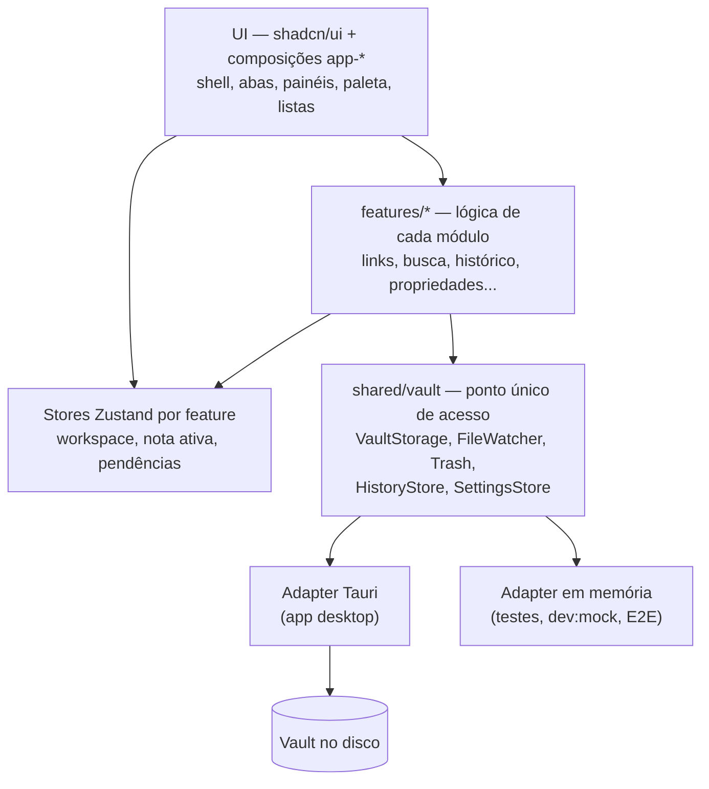
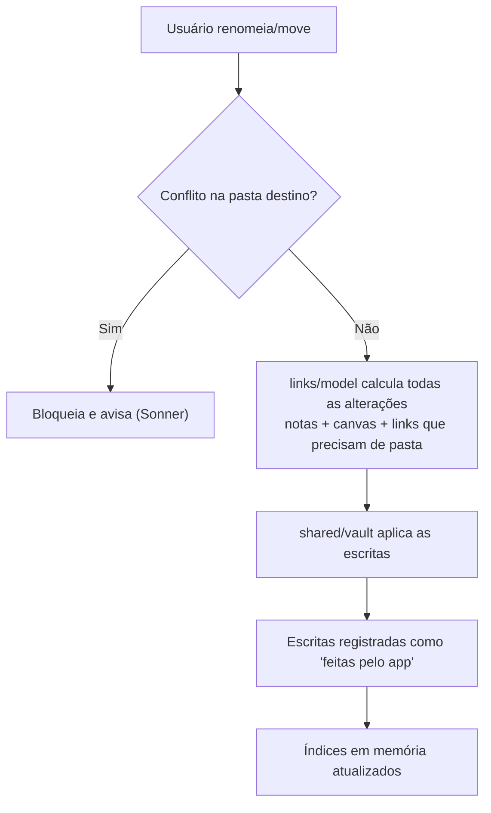

# Dev Notes — Arquitetura (MVP)

| Campo | Valor |
| --- | --- |
| Versão | 0.3 |
| Data | 2026-09-29 |
| Status | Rascunho — decisões marcadas como **Proposto** aguardam confirmação |
| Base funcional | `regras-de-negocio.md` v1.1 |
| Base de código | [react-standards-template](https://github.com/thiagocorreanet/react-standards-template) |
| Identidade visual | `brand.md` (paleta, fontes, tokens, logo) |

---

## 1. Princípios

1. **Os arquivos são a fonte da verdade.** Notas (`.md`) e canvas (`.canvas`) no disco valem mais que qualquer estado em memória. Índices são descartáveis e reconstruíveis.
2. **Local-first e offline.** Nenhuma funcionalidade do MVP depende de rede.
3. **Ponto único de mudança.** Todo acesso ao sistema operacional passa por `shared/vault`. Trocar Tauri por web, ou incluir Git/sync no futuro, altera só o adapter.
4. **Toda a interface sai do shadcn.** Componentes, layout e padrões de tela são montados com primitivas do shadcn e composições reutilizáveis em `shared/components/`. Nenhuma tela inventa seu próprio botão, lista, diálogo ou painel.
5. **Padrões do template valem aqui.** Regras com código (`NOM-01`, `CMP-02`, `COR-01`...) do `docs/standards.md` herdado continuam obrigatórias, com as adaptações da seção 3.
6. **Formatos abertos.** Markdown com propriedades no topo (frontmatter YAML) e canvas em JSON Canvas, compatíveis com Obsidian.

---

## 2. Stack

| Camada | Tecnologia | Origem |
| --- | --- | --- |
| Shell desktop | **Tauri 2** | Novo |
| UI | **React 19 + TypeScript + Vite** | Template |
| Componentes | **shadcn/ui (preset `base-nova`, Base UI) + Tailwind 4 + lucide** | Template |
| Fontes | **Inter + JetBrains Mono** (pacotes locais `@fontsource-variable/*`, no lugar da Geist) | Novo |
| Avisos | **sonner** (via shadcn) | Template |
| Validação | **Zod** (frontmatter, `.canvas`, `.devnotes/*.json`) | Template |
| Formulários | **TanStack Form** (propriedades, configurações) | Template |
| Editor | **CodeMirror 6** | Novo |
| Canvas | **React Flow (@xyflow/react)** | Novo |
| Markdown | **unified / remark** | Novo |
| Busca | **MiniSearch** | Novo |
| Estado | **Zustand** | Novo (exceção documentada, ADR-006) |
| Qualidade | **Biome, Vitest, Testing Library, Playwright** | Template |
| Ambiente | **Node 24, pnpm** | Template |

---

## 3. Adaptação do template

| Herdado e mantido | Removido | Adicionado |
| --- | --- | --- |
| Estrutura `features/` + `shared/` com fronteira por `index.ts` | Módulo `auth` e exemplo `items` | `src-tauri/` (núcleo Rust) |
| `docs/standards.md`, `docs/decisions/`, `CLAUDE.md` | Camada HTTP (`ky`, `shared/api`, contrato de API, CSRF) | `shared/vault/` no lugar de `shared/api/` |
| Skill `app-review-standards` e MCP do shadcn | TanStack Router e regras `ROT-*` | `app/` com o shell do workspace |
| Biome, Vitest, Playwright, pnpm | TanStack Query e TanStack Table | Zustand, CodeMirror, React Flow, remark, MiniSearch |
| Tema claro/escuro/sistema (`ThemeProvider`) | Mocks MSW | Adapter de vault em memória (`dev:mock`) |
| Regras `NOM`, `COD`, `IDI`, `CMP-01..04, 07..10`, `COR` | `CMP-05` (tabela) e `CMP-06` (erro HTTP) | Regras `LAY-*` (seção 6) |

---

## 4. Visão em camadas



**Por que `shared/vault` passa na regra `COD-04`** ("sem abstração antes do segundo uso"): existem dois usos reais desde o primeiro dia, o adapter Tauri e o adapter em memória usado por Vitest, Playwright e `pnpm dev:mock`.

---

## 5. Estrutura do repositório

```
dev-notes/
├── src/
│   ├── config/
│   │   ├── app.ts                  # nome, idioma, atalhos padrão
│   │   └── commands.ts             # catálogo tipado da paleta (RN-UI-003)
│   ├── app/
│   │   ├── root.tsx                # ThemeProvider + <Toaster> único (CMP-09)
│   │   └── workspace.tsx           # monta o app-shell
│   ├── features/
│   │   ├── vault/                  # explorador, excluir, renomear, mover
│   │   ├── editor/                 # CodeMirror + extensões
│   │   ├── links/                  # links, links pendentes/quebrados, incorporação
│   │   ├── backlinks/              # painel de backlinks e menções sem link
│   │   ├── canvas/
│   │   ├── search/                 # busca rápida e completa
│   │   ├── command-palette/
│   │   ├── workspace/              # abas, painéis, layout salvo
│   │   ├── properties/
│   │   ├── tags/
│   │   ├── daily-notes/
│   │   ├── templates/
│   │   ├── snippets/
│   │   └── history/
│   ├── shared/
│   │   ├── vault/                  # ports + adapters (tauri, memory)
│   │   ├── components/ui/          # gerado pelo shadcn, nunca editado (CMP-01)
│   │   ├── components/             # composições app-* reutilizáveis (seção 6.2)
│   │   ├── hooks/
│   │   └── lib/
│   ├── mocks/                      # vault de demonstração em memória
│   └── styles.css                  # tokens de cor, fontes e tema (COR-*), definidos em docs/brand.md
├── public/favicon.svg              # logo (brand.md 1.1)
├── src-tauri/                      # icons/ gerados com `pnpm tauri icon`
├── docs/
│   ├── standards.md
│   ├── arquitetura.md
│   ├── regras-de-negocio.md
│   ├── brand.md                    # identidade visual
│   └── decisions/                  # um arquivo por decisão
├── e2e/
└── CLAUDE.md
```

**Anatomia de uma feature** (segue `NOM-04` e `NOM-05`: só nasce o arquivo usado, nome começa pelo assunto):

```
features/links/
├── components/        # links-panel.tsx ...
├── model/             # lógica pura: links.resolver.ts, links.rename.ts
├── types/             # links.schemas.ts (Zod) e tipos inferidos
├── tests/             # critérios CA-* viram testes aqui
├── links.store.ts     # só se a feature tiver estado global
├── index.ts           # contrato público (NOM-06)
└── README.md          # regras RN-* do módulo (COD-03)
```

`model/` substitui o `api/` do template: em vez de serviços HTTP, contém regras puras que usam `shared/vault`.

---

## 6. Padrão de interface com shadcn

### 6.1 Mapa de telas → componentes shadcn

| Parte da tela | Componentes shadcn |
| --- | --- |
| Estrutura geral (esquerda, centro, direita) | `Sidebar` + `Resizable` |
| Explorador de arquivos (árvore) | `Sidebar` (menu) + `Collapsible` + `Context Menu` |
| Abas de notas | `Tabs` + `Button` (fechar) + `Tooltip` |
| Painéis divididos | `Resizable` |
| Paleta de comandos e busca rápida | `Command` (em `Dialog`) + `Kbd` |
| Busca completa e filtros | `Input Group` + `Command`/`Combobox` (autocomplete de filtros) + `Scroll Area` + `Item` |
| Backlinks e menções sem link | `Item` + `Collapsible` (seção recolhida) + `Button` |
| Propriedades | `Field` + `Input` + `Switch` + `Date Picker` + `Combobox` (lista) + `Badge` |
| Valor inválido em propriedade | `Field` (estado de erro) + ícone + texto (CMP-08) |
| Tags | `Badge` |
| Histórico de versões | `Item` + `Scroll Area` + `Alert Dialog` (restaurar) |
| Snippets | `Item` + `Toggle Group` ou `Select` (linguagem) |
| Nota diária | `Button` + `Calendar` (escolher data) |
| Confirmações (excluir nota/pasta) | `Alert Dialog` |
| Conflito de edição externa | `Alert Dialog` com duas ações |
| Avisos de sucesso/erro | `Sonner` |
| Estados vazios | `Empty` |
| Carregamento | `Skeleton` / `Spinner` |
| Menus de ação | `Dropdown Menu` |
| Configurações | `Dialog` + `Tabs` + `Field` |
| Barra do canvas | `Button Group` + `Toggle Group` + `Tooltip` |

### 6.2 Composições reutilizáveis (`shared/components/`)

Peças que montam telas inteiras levam o prefixo `app-` (CMP-04). Toda tela nova usa estas peças antes de compor algo novo.

| Composição | Monta | Usada por |
| --- | --- | --- |
| `app-shell` | `Sidebar` esquerda + área central + painel direito (`aside`, opcional), dentro de `Resizable` | Toda a aplicação; o lado direito recebe o painel de backlinks |
| `app-tabs` | Abas de nota com fechar, indicador de alteração pendente e menu | workspace, editor, canvas |
| `app-panel` | Cabeçalho (título + ações) + `Scroll Area`; o vazio fica com quem usa (`app-empty`) | backlinks (desde a spec 003), histórico, propriedades, snippets, tags |
| `app-note-list` | Lista de notas com `Item`: ícone, nome, pasta e trechos clicáveis, cada um com ação opcional | backlinks (desde a spec 003), busca, histórico, snippets |
| `app-confirm` | `Alert Dialog` padrão de confirmação; `tone="default"` quando nada é destruído | excluir nota/pasta, restaurar versão, recriar nota excluída |
| `app-choice-dialog` | `Alert Dialog` com duas opções nomeadas | conflito de edição externa |
| `app-command` | `Command` em `Dialog`, com grupos e atalhos `Kbd` | paleta de comandos, busca rápida |
| `app-empty` | `Empty` com ícone, texto e ação | vault vazio, sem resultados, painel vazio |
| `app-editor-frame` | Moldura do CodeMirror com tokens do tema | editor, incorporação |
| `app-canvas-frame` | Moldura do React Flow com tokens e barra de ferramentas | canvas |

### 6.3 Regras de layout (`LAY-*`)

Somam-se às regras `CMP-*` e `COR-*` do template.

**LAY-01 — Toda tela vive dentro do `app-shell`** · DEVE
Nenhuma feature cria estrutura própria de página.

**LAY-02 — Lista de notas usa `app-note-list`** · DEVE
Busca, backlinks, histórico e snippets exibem notas do mesmo jeito.

**LAY-03 — Painel lateral usa `app-panel`** · DEVE
Mesmo cabeçalho, rolagem e estado vazio em todos os painéis.

**LAY-04 — Ação destrutiva confirma com `app-confirm`** · DEVE
Cobre RN-NOTA-002, RN-NOTA-009 e restauração de versão.

**LAY-05 — Redimensionar só com `Resizable`** · NÃO DEVE usar arraste feito à mão.

**LAY-06 — Todo comando tem atalho visível com `Kbd`** · DEVERIA
Na paleta, em tooltips e menus.

**LAY-07 — Editor e canvas são as únicas exceções ao shadcn** · DEVE
CodeMirror e React Flow não existem no shadcn. Ficam dentro de `app-editor-frame` e `app-canvas-frame`, usam só tokens de `styles.css` (COR-01) e o motivo fica no `README.md` da feature (CMP-02). Toda interface ao redor deles (barras, menus, diálogos) continua sendo shadcn.

**LAY-08 — Componente novo passa primeiro pelo MCP do shadcn** · DEVE
Antes de compor algo, consultar se o shadcn já tem a peça; compor só se não tiver.

**LAY-09 — Cores, fontes e medidas vêm de `docs/brand.md`** · DEVE
Ações usam `primary`; destaque e links usam `brand`. Cor nova só entra pelo `brand.md` e pelos três lugares da COR-02.

---

## 7. `shared/vault`

| Interface | Responsabilidade | Adapter Tauri | Adapter em memória |
| --- | --- | --- | --- |
| `VaultStorage` | Listar, ler, escrever, renomear, mover | Plugin `fs` | Mapa em memória |
| `FileWatcher` | Avisar mudanças externas | Plugin `fs` (watch) | Evento disparado pelo teste |
| `Trash` | Enviar para a lixeira do sistema | Comando Rust (crate `trash`) | Lista de removidos |
| `AppDataStore` | Ler e gravar os dados do app no vault (`.devnotes/<nome>.json`) | Comandos Rust `vault_app_data_*` | Mesmo mapa das notas, em `.devnotes/` |
| `HistoryStore` | Versões por 30 dias | `.devnotes/history/` | Mapa em memória |
| `SettingsStore` | Configurações e layout | `.devnotes/*.json` validados por Zod | Mapa em memória |

`VaultSession` (escolher, abrir e reabrir o vault), `VaultStorage`,
`FileWatcher` e `Trash` existem desde a spec 001
(`specs/001-vault-notas/contracts/shared-vault.md`). A spec 002 acrescenta
`AppDataStore` e a data de modificação de cada entrada (`VaultEntry.modifiedAt`,
usada na ordem do autocomplete) (`specs/002-links-incorporacao/contracts/shared-vault.md`).
`HistoryStore` e `SettingsStore` entram com as specs de histórico e de abas,
sobre o mesmo `AppDataStore`.

**Núcleo Rust** (`src-tauri/src/vault.rs`), chamado só pelo adapter Tauri:

| Comando | Para quê |
| --- | --- |
| `vault_pick` | seletor de pasta nativo; libera a pasta no escopo do `fs` e grava o último vault |
| `vault_restore` | lê o último vault e libera de novo a pasta, se ela ainda existir |
| `vault_scan` | lista o vault inteiro num IPC só, sem ocultos e sem seguir links simbólicos |
| `vault_read_notes` | lê notas em lote, com o BOM original (o `readTextFile` do plugin descarta o BOM) |
| `vault_trash` | envia para a lixeira do sistema (crate `trash`); qualquer erro vira `trash-unavailable` |
| `vault_app_data_read`, `vault_app_data_write` | leem e gravam `<raiz>/.devnotes/<nome>.json` (ADR-009); só nomes `^[a-z0-9-]+.json$`, nunca seguem link simbólico nem saem da raiz |

Todo caminho recebido pelos comandos é validado dentro da raiz do vault
(`resolve_in_vault`), com `cargo test`. Os dados do app usam comandos próprios
porque, no macOS e no Linux, o escopo `raiz/**` do Tauri não cobre pastas
iniciadas por ponto (spec 002, research R4).

**Configuração global do app**: `AppConfig/vault.json` (no Windows,
`%APPDATA%\dev.devnotes.app\vault.json`) guarda só o último vault aberto,
fora do vault (constituição, princípio II).

---

## 8. Vault no disco

```
meu-vault/
├── diario/                 # AAAA-MM-DD.md (pasta configurável)
├── templates/
├── snippets/
├── qualquer-pasta/
│   ├── nota.md
│   └── arquitetura.canvas
└── .devnotes/
    ├── deleted-notes.json  # notas excluídas: link quebrado × pendente (spec 002)
    ├── config.json
    ├── workspace.json      # abas e painéis (RN-UI-001)
    └── history/            # RN-HIST-001..003
```

Índices de busca e de links ficam só em memória. Os arquivos de `.devnotes/`
são auxílio, nunca verdade sobre as notas: ausente ou inválido vira vazio, e
apagar a pasta não perde nenhuma nota (ADR-009).

---

## 9. Regras de negócio → features

| Regras | Feature |
| --- | --- |
| RN-NOTA-001..012 | `vault` (+ `links` para atualização de links) |
| RN-LINK-*, RN-EMBED-* | `links` (regra pura: estado, sugestões, seções, incorporação); `vault` segue o link e cria a nota pendente (`followLink`); `editor` destaca, sugere e mostra os blocos |
| RN-BACK-* | `backlinks` (painel, agrupamento e trechos); `links` (regra da menção: `findMentions`, `mentionLink`, texto no índice); `vault` grava a menção como link (`linkMention`); `editor` abre no ponto (`open` com `offset`) |
| RN-CANVAS-* | `canvas` |
| RN-BUSCA-* | `search` |
| RN-UI-* | `command-palette`, `workspace` |
| RN-TAG-* | `tags` |
| RN-PROP-* | `properties` |
| RN-DIARIO-* | `daily-notes` |
| RN-TEMPLATE-* | `templates` |
| RN-SNIPPET-* | `snippets` |
| RN-HIST-* | `history` |

Critérios `CA-*` viram testes Vitest em `features/*/tests/`, rodando contra o adapter em memória. Jornadas principais (criar, linkar, renomear, excluir) viram testes Playwright em `e2e/`, com o front no navegador e o mesmo adapter.

---

## 10. Fluxos técnicos críticos

### 10.1 Renomear ou mover nota



O conjunto completo de mudanças é calculado **antes** de escrever qualquer arquivo.

### 10.2 Mudança externa sem loop

O adapter registra cada escrita do próprio app e ignora o evento correspondente do `FileWatcher`. Só eventos não reconhecidos seguem para RN-NOTA-007/008.

---

## 11. Decisões (viram arquivos em `docs/decisions/`)

| ID | Decisão | Status | Tradeoff |
| --- | --- | --- | --- |
| ADR-001 | Tauri 2 como shell desktop | **Aceito** (`decisions/0010`) | Leve vs. WebView diferente por sistema |
| ADR-002 | Usar o react-standards-template como base | **Aceito** | Padrão, revisão por IA e consistência vs. remover a parte HTTP/auth |
| ADR-003 | Interface 100% shadcn (Base UI), com composições `app-*` e regras `LAY-*` | **Aceito** | Padronização e reaproveitamento vs. exemplos da comunidade usam mais Radix (`asChild`) que Base UI (`render`) |
| ADR-004 | CodeMirror 6 como editor | **Aceito** (`decisions/0011`) | Extensível vs. API de baixo nível |
| ADR-005 | React Flow + JSON Canvas | Proposto | Pronto e compatível vs. menos liberdade visual |
| ADR-006 | Zustand para estado de workspace | **Aceito** (`decisions/0012`) | Estado global real (abas, nota ativa, pendências) vs. exceção à regra do template de evitar store global |
| ADR-007 | MiniSearch em memória | Proposto | Zero infraestrutura vs. peso em vaults muito grandes |
| ADR-008 | `shared/vault` com adapters Tauri e memória | **Aceito** (`decisions/0013`) | Testes e `dev:mock` sem Tauri vs. mais interfaces |
| ADR-009 | Dados do app em `.devnotes/` | **Aceito** (`decisions/0015`) | Vault portátil vs. pasta extra a ignorar quando houver Git |
| ADR-010 | Não usar Yjs no MVP | Proposto | Menos complexidade vs. integrar depois para colaboração |
| ADR-011 | Remover TanStack Router, Query e Table | **Aceito** (`decisions/0014`) | Menos dependências vs. perder convenções herdadas (sem uso real aqui) |
| ADR-012 | Identidade visual do `brand.md`, com `--primary` em `#2563EB` | **Aceito** | Contraste acessível (5,17:1) vs. leve diferença do azul do logo (`#3B82F6`), mantido como `--brand` |

---

## 12. Build e distribuição

- Builds Windows, Linux e macOS via GitHub Actions (`tauri-action`), publicados em GitHub Releases.
- `pnpm verify` herdado (Biome, TypeScript, testes, build) roda antes do build desktop.
- Atualização automática fora do MVP.

---

## 13. Riscos

| Risco | Mitigação |
| --- | --- |
| WebView diferente por sistema | Testar nas três plataformas desde o início |
| Exemplos de shadcn na internet usam Radix (`asChild`) | Instalar sempre via MCP/CLI do shadcn com o preset do `components.json`; revisão cobra CMP-03 |
| Vault grande deixa abertura lenta | Indexação incremental; plano B no Rust (ADR-007) |
| Loop entre salvar e observar | Registro de escritas do app (10.2) |
| Renomear com muitos links falha no meio | Calcular tudo antes, aplicar em sequência, reportar pendentes |
| Lixeira indisponível em algumas distros Linux | Bloquear a exclusão e avisar o usuário, que pode excluir pelo gerenciador de arquivos (spec 001, FR-024) |

---

## 14. Pendências

- Confirmar decisões com status **Proposto**.
- Licença open source.
- Nome oficial (DevNotes x Dev Notes) e logo em SVG (ver `brand.md`).
