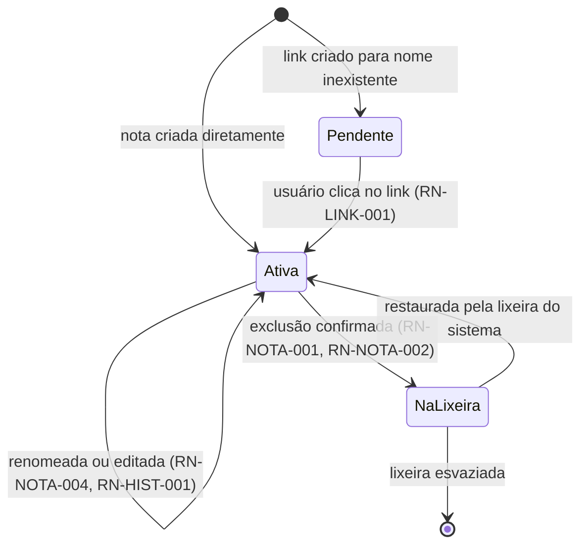
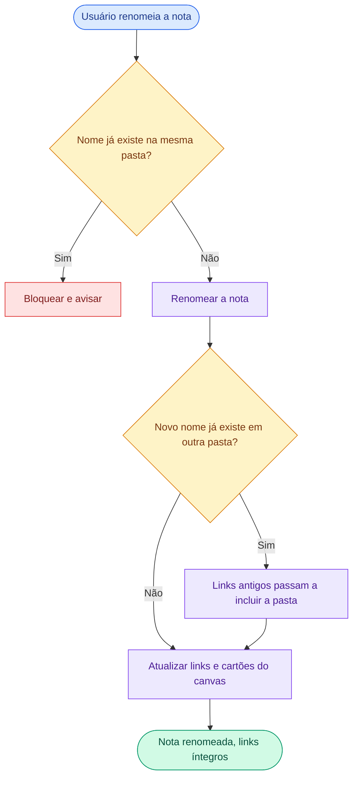
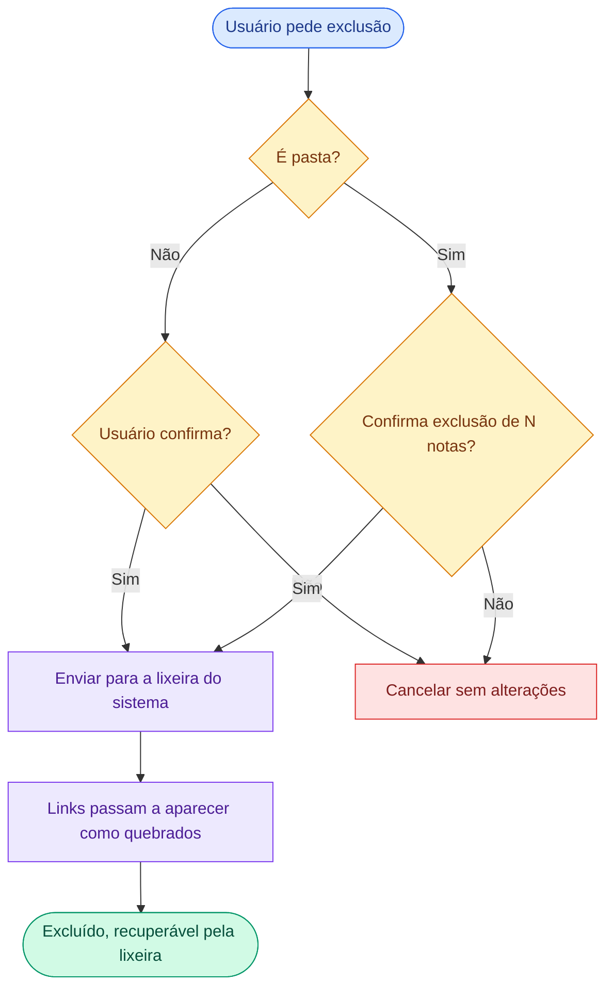
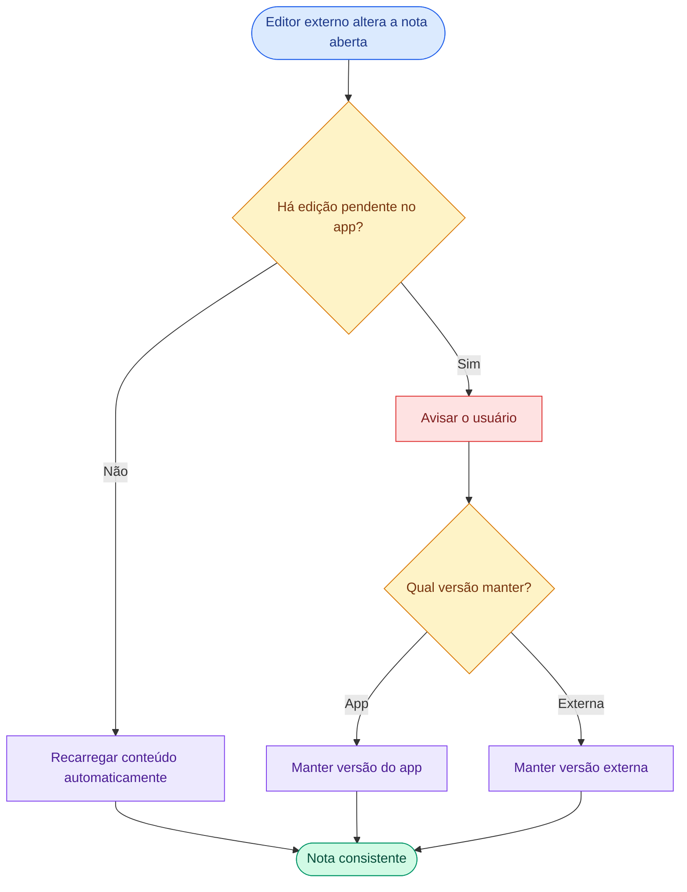

# Dev Notes — Regras de Negócio (MVP)

| Campo | Valor |
| --- | --- |
| Produto | Dev Notes |
| Versão do documento | 1.1 |
| Data | 2026-09-29 |
| Status | Consolidado para o MVP |
| Maturidade | **COMPLETO** (ver seção 13) |
| Fonte | Sessão de discovery com o responsável pelo produto, 2026-09-29 |

---

## 1. Contexto e objetivo

**Problema.** Desenvolvedores precisam de um caderno de conhecimento pessoal (anotações, comandos, snippets, decisões, runbooks) que seja rápido, funcione offline e não prenda os dados em formato proprietário. A referência de mercado (Obsidian) é gratuita, mas não é open source e não tem recursos pensados para devs.

**Objetivo.**
- OBJ-PROD-001: Oferecer um app de notas **open source**, com as funcionalidades centrais do Obsidian, voltado a desenvolvedores. `[DEFINIDO]`
- OBJ-PROD-002: Diferenciar-se com recursos específicos para devs (biblioteca de snippets, busca com filtros, paleta de comandos). `[DEFINIDO]`

**Resultado esperado.** O dev mantém suas notas em arquivos Markdown no próprio computador, conecta ideias por links e visualiza relações num canvas, sem depender de servidor ou internet.

---

## 2. Escopo

### 2.1 No MVP `[DEFINIDO]`

| Funcionalidade | Origem |
| --- | --- |
| Vault (pasta local de notas `.md`) | Paridade Obsidian |
| Editor Markdown com destaque de código | Paridade Obsidian |
| Links internos `[[nota]]` e backlinks | Paridade Obsidian |
| Busca | Paridade Obsidian |
| Templates criados pelo usuário | Paridade Obsidian |
| Canvas (cartões de nota e de texto, setas, zoom, arrastar) | Paridade Obsidian |
| Tags hierárquicas | Paridade Obsidian |
| Propriedades da nota | Paridade Obsidian |
| Notas diárias | Paridade Obsidian |
| Incorporar nota em outra (`![[nota]]`) | Paridade Obsidian |
| Abas, painéis divididos e paleta de comandos | Paridade Obsidian |
| Histórico de versões da nota | Paridade Obsidian |
| Biblioteca de snippets | Diferencial |

### 2.2 Evolução futura `[EVOLUÇÃO FUTURA]`

Grafo de notas; plugins e temas da comunidade; sync entre dispositivos; publicação de notas como site; mobile; vault versionado com Git; edição colaborativa em tempo real; blocos de código executáveis; links para issues/PRs do GitHub; canvas com imagens, links web, cores, grupos e desenho livre; busca por expressão regular; buscas salvas.

### 2.3 Fora do escopo deste documento `[FORA DO ESCOPO]`

Stack e decisões técnicas (framework, empacotamento desktop, bibliotecas, formato interno de armazenamento). Serão tratadas em documento de arquitetura.

---

## 3. Glossário

| Termo | Definição | Não confundir com |
| --- | --- | --- |
| Vault | Pasta no computador do usuário que contém todas as notas, canvas, templates e snippets | Projeto de código / repositório |
| Nota | Arquivo `.md` dentro do vault | Cartão de texto do canvas |
| Link interno | Referência a outra nota no formato `[[nome]]` ou `[[pasta/nome]]` | Link web (URL) |
| Backlink | Lista de notas que apontam para a nota atual | Link interno |
| Link pendente | Link para nota que ainda não existe; seguir o link cria a nota | Link quebrado |
| Link quebrado | Link para nota que existia e foi excluída; o app lembra a exclusão num registro de notas excluídas (`.devnotes/deleted-notes.json`), que guarda só caminhos e pode ser apagado sem perda | Link pendente |
| Incorporação | Exibição do conteúdo de uma nota dentro de outra (`![[nota]]`) | Cópia do conteúdo |
| Canvas | Quadro infinito com cartões ligados por setas, salvo como arquivo no vault | Nota |
| Cartão | Elemento do canvas: referência a uma nota ou texto livre | Nota |
| Tag | Marcador `#tag`, podendo ser hierárquico (`#backend/api`) | Propriedade |
| Propriedade | Informação estruturada no topo da nota (ex.: autor, status, linguagem) | Tag |
| Nota diária | Nota associada a uma data | Nota comum |
| Template | Modelo usado para criar notas | Snippet |
| Snippet | Nota com trecho de código reutilizável, identificada por linguagem | Template |
| Versão | Estado anterior salvo de uma nota | Cópia manual |
| Lixeira | Lixeira do sistema operacional | Pasta do vault |

---

## 4. Atores

| Ator | Descrição |
| --- | --- |
| Usuário (dev) | Único ator do MVP. Cria, edita, organiza, exclui e restaura suas notas no próprio computador. `[DEFINIDO]` |
| Leitor externo | Qualquer pessoa (inclusive de outras áreas) que lê os `.md` fora do app. Não interage com o Dev Notes. `[DEFINIDO]` |
| Editor externo | Outra ferramenta (ex.: editor de código) que altera arquivos do vault enquanto o app está aberto. `[DEFINIDO]` |

Não há multiusuário, permissões ou aprovações no MVP; por isso não há matriz de responsabilidades.

---

## 5. Decisões de produto

| ID | Decisão | Alternativas consideradas | Classificação |
| --- | --- | --- | --- |
| DEC-PROD-001 | Público-alvo são desenvolvedores; os `.md` podem ser lidos por qualquer área | App de notas genérico | `[DEFINIDO]` |
| DEC-PROD-002 | MVP é um caderno pessoal do dev (um vault por usuário) | Documentação de time dentro do repositório | `[DEFINIDO]` |
| DEC-PROD-003 | App desktop; notas ficam no computador do usuário e funcionam offline; sem servidor no MVP | Aplicação web | `[DEFINIDO]` |
| DEC-PROD-004 | Integração com Git fora do MVP | Git no MVP | `[DEFINIDO]` |
| DEC-PROD-005 | Canvas no MVP, versão enxuta; custo de tempo aceito | Canvas na fase 2 | `[DEFINIDO]` |
| DEC-PROD-006 | Tags, propriedades, notas diárias, incorporação, abas/paleta de comandos e histórico no MVP | Fase 2 | `[DEFINIDO]` |
| DEC-PROD-007 | Plugins fora do MVP | Plugins no MVP | `[DEFINIDO]` |
| DEC-PROD-008 | Sync e Publish, quando existirem, serão gratuitos e open source | Recursos pagos | `[DEFINIDO]` |
| DEC-PROD-009 | Biblioteca de snippets no MVP; blocos executáveis e links GitHub no futuro (risco de segurança e dependência de internet) | Todos no MVP | `[DEFINIDO]` — escolha delegada pelo responsável e aceita |
| DEC-PROD-010 | Exclusão envia para a lixeira do sistema | Pasta `.trash` no vault; exclusão definitiva | `[DEFINIDO]` |
| DEC-PROD-011 | Clicar em link pendente cria a nota | Apenas avisar | `[DEFINIDO]` |
| DEC-PROD-012 | Nomes repetidos em pastas diferentes são permitidos; link inclui a pasta só quando necessário | Exigir caminho sempre; proibir repetição | `[DEFINIDO]` |
| DEC-PROD-013 | Alteração externa: recarrega se não houver edição pendente; senão, usuário escolhe | Sempre sobrescrever; sempre recarregar | `[DEFINIDO]` |
| DEC-PROD-014 | Renomear que gera nome repetido atualiza links antigos para incluir a pasta | Bloquear a renomeação | `[DEFINIDO]` |
| DEC-PROD-015 | Busca em nome, conteúdo, tags e propriedades, com filtros combinados e busca rápida por nome | Busca só por nome/conteúdo, sem filtros | `[DEFINIDO]` |
| DEC-PROD-016 | Backlinks mostram links e, em seção recolhida, menções sem link | Só links; menções sempre visíveis | `[DEFINIDO]` |
| DEC-PROD-017 | Layout de abas lembrado e paleta de comandos estilo VS Code | Layout sempre limpo ao abrir | `[DEFINIDO]` |
| DEC-PROD-018 | Templates dev prontos (ADR, runbook, snippet, postmortem) removidos do projeto; permanecem apenas templates criados pelo usuário | Manter templates dev | `[DEFINIDO]` |
| DEC-PROD-019 | Mover nota segue o mesmo comportamento de renomear (atualiza links) | Mover sem atualizar links | `[DEFINIDO]` |
| DEC-PROD-020 | Tipos de propriedade: texto, número, data, lista, sim/não (compatíveis com Obsidian) | Apenas texto | `[DEFINIDO]` |
| DEC-PROD-021 | Valor inválido em propriedade é mantido e sinalizado, nunca apagado | Apagar ou converter o valor | `[DEFINIDO]` |

---

## 6. Catálogo de regras

Todas as regras abaixo são `[DEFINIDO]` e **vigentes**, salvo indicação.

### 6.1 Notas

| ID | Regra | Tipo | Origem |
| --- | --- | --- | --- |
| RN-NOTA-001 | Excluir uma nota envia o arquivo para a lixeira do sistema operacional | Obrigação | DEC-PROD-010 |
| RN-NOTA-002 | Antes de excluir uma nota, o app pede confirmação ao usuário | Validação | DEC-PROD-010 |
| RN-NOTA-003 | Links para uma nota excluída permanecem no texto e são exibidos como link quebrado | Integridade | DEC-PROD-010 |
| RN-NOTA-004 | Ao renomear uma nota, todos os links que apontam para ela são atualizados automaticamente | Integridade | Sessão 2026-09-29 |
| RN-NOTA-005 | Cartões do canvas que referenciam a nota renomeada também são atualizados | Integridade | Derivada de RN-NOTA-004, confirmada |
| RN-NOTA-006 | Renomear uma nota para um nome que já existe **na mesma pasta** é bloqueado, com aviso | Restrição | Stress test, confirmada |
| RN-NOTA-007 | Se uma nota aberta for alterada por outra ferramenta e **não houver** edição pendente no app, o app recarrega o conteúdo automaticamente | Integridade | DEC-PROD-013 |
| RN-NOTA-008 | Se uma nota aberta for alterada por outra ferramenta e **houver** edição pendente no app, o app avisa e o usuário escolhe qual versão manter | Integridade | DEC-PROD-013 |
| RN-NOTA-009 | Excluir uma pasta envia todas as notas dela para a lixeira, após confirmação que informa a quantidade de notas | Validação | Stress test, confirmada |
| RN-NOTA-010 | Ao mover uma nota de pasta, todos os links e cartões do canvas que apontam para ela são atualizados automaticamente | Integridade | DEC-PROD-019 |
| RN-NOTA-011 | Mover uma nota para pasta que já contém nota com o mesmo nome é bloqueado, com aviso | Restrição | DEC-PROD-019 |
| RN-NOTA-012 | Se mover a nota torna seu nome repetido no vault, aplica-se RN-LINK-006 | Integridade | DEC-PROD-019 |

### 6.2 Links

| ID | Regra | Tipo | Origem |
| --- | --- | --- | --- |
| RN-LINK-001 | Clicar em um link pendente cria a nota com aquele nome | Obrigação | DEC-PROD-011 |
| RN-LINK-002 | Links pendentes são exibidos com aparência diferente dos links válidos | Obrigação | DEC-PROD-011 |
| RN-LINK-003 | Notas com o mesmo nome em pastas diferentes são permitidas | Restrição | DEC-PROD-012 |
| RN-LINK-004 | Se o nome da nota é único no vault, o link usa só o nome (`[[api]]`); se houver repetição, o link inclui a pasta (`[[backend/api]]`) | Derivação | DEC-PROD-012 |
| RN-LINK-005 | O autocomplete de links inclui a pasta automaticamente quando o nome for repetido | Obrigação | DEC-PROD-012 |
| RN-LINK-006 | Quando uma renomeação torna um nome repetido, os links existentes que usavam só o nome passam a incluir a pasta, preservando o destino original | Integridade | DEC-PROD-014 |

### 6.3 Incorporação

| ID | Regra | Tipo | Origem |
| --- | --- | --- | --- |
| RN-EMBED-001 | `![[nota]]` exibe o conteúdo da nota incorporada e reflete automaticamente as alterações da original | Obrigação | Sessão 2026-09-29 |
| RN-EMBED-002 | Incorporação de nota excluída ou inexistente é exibida como "nota não encontrada" | Integridade | Stress test, confirmada |
| RN-EMBED-003 | Incorporação circular (A incorpora B que incorpora A) é interrompida com aviso, sem travar o app | Restrição | Stress test, confirmada |

### 6.4 Canvas

| ID | Regra | Tipo | Origem |
| --- | --- | --- | --- |
| RN-CANVAS-001 | Remover um cartão do canvas não exclui a nota original | Restrição | Sessão 2026-09-29 |
| RN-CANVAS-002 | Cartão que referencia nota excluída é exibido como "nota não encontrada" | Integridade | Stress test, confirmada |
| RN-CANVAS-003 | O canvas é salvo como arquivo no vault, em formato aberto e legível por outras ferramentas | Obrigação | Sessão 2026-09-29 |

### 6.5 Tags e propriedades

| ID | Regra | Tipo | Origem |
| --- | --- | --- | --- |
| RN-TAG-001 | Tags podem ser hierárquicas (`#backend/api`) | Restrição | Sessão 2026-09-29 |
| RN-TAG-002 | Filtrar por uma tag inclui as notas com suas tags filhas (`#backend` inclui `#backend/api`) | Derivação | Sessão 2026-09-29 |
| RN-PROP-001 | Propriedades ficam no topo da nota e podem ser editadas por formulário ou como texto | Obrigação | Sessão 2026-09-29 |
| RN-PROP-002 | Os tipos de propriedade do MVP são: texto, número, data, lista e sim/não | Restrição | DEC-PROD-020 |
| RN-PROP-003 | Valor que não combina com o tipo da propriedade é mantido sem alteração e sinalizado com aviso visual | Integridade | DEC-PROD-021 |

### 6.6 Notas diárias

| ID | Regra | Tipo | Origem |
| --- | --- | --- | --- |
| RN-DIARIO-001 | A nota diária é nomeada no formato `AAAA-MM-DD` e criada na pasta `diario/`, configurável pelo usuário | Obrigação | Sessão 2026-09-29 |
| RN-DIARIO-002 | Abrir a nota diária de uma data que já possui nota abre a existente, sem criar outra | Restrição | Stress test, confirmada |

### 6.7 Templates e snippets

| ID | Regra | Tipo | Origem |
| --- | --- | --- | --- |
| RN-TEMPLATE-001 | Templates ficam na pasta `templates/` do vault | Obrigação | Sessão 2026-09-29 |
| RN-TEMPLATE-002 | ~~O app vem com templates dev prontos (ADR, runbook, snippet, postmortem) e o usuário pode criar os próprios~~ **Revogada** por DEC-PROD-018; substituída por RN-TEMPLATE-003 | — | DEC-PROD-018 |
| RN-TEMPLATE-003 | O usuário pode criar os próprios templates; o app não traz templates prontos | Obrigação | DEC-PROD-018 |
| RN-SNIPPET-001 | Cada snippet é uma nota na pasta `snippets/`, com a propriedade `linguagem` | Obrigação | DEC-PROD-009 |
| RN-SNIPPET-002 | A biblioteca de snippets permite filtrar pela propriedade `linguagem` | Obrigação | DEC-PROD-009 |

### 6.8 Histórico de versões

| ID | Regra | Tipo | Origem |
| --- | --- | --- | --- |
| RN-HIST-001 | Versões anteriores de cada nota são guardadas localmente por 30 dias | Temporal | Sessão 2026-09-29 |
| RN-HIST-002 | O usuário pode restaurar qualquer versão dentro do período de 30 dias | Obrigação | Sessão 2026-09-29 |
| RN-HIST-003 | Restaurar uma versão gera uma nova versão, permitindo desfazer a restauração | Reversibilidade | Stress test, confirmada |

### 6.9 Busca

| ID | Regra | Tipo | Origem |
| --- | --- | --- | --- |
| RN-BUSCA-001 | A busca procura em nome, conteúdo (incluindo blocos de código), tags e propriedades | Obrigação | DEC-PROD-015 |
| RN-BUSCA-002 | A busca aceita filtros combinados no mesmo termo (ex.: `deploy tag:#backend linguagem:csharp pasta:snippets`) | Obrigação | DEC-PROD-015 |
| RN-BUSCA-003 | A busca não diferencia maiúsculas/minúsculas nem acentos | Derivação | DEC-PROD-015 |
| RN-BUSCA-004 | Resultados com o termo no nome da nota aparecem antes dos que o têm só no conteúdo | Obrigação | DEC-PROD-015 |
| RN-BUSCA-005 | Existem duas buscas: rápida por nome (para abrir nota) e completa (conteúdo e filtros) | Obrigação | DEC-PROD-015 |
| RN-BUSCA-006 | Ao digitar um filtro (`tag:`, `pasta:`, propriedade), o app sugere os valores existentes | Obrigação | DEC-PROD-015 |

### 6.10 Backlinks

| ID | Regra | Tipo | Origem |
| --- | --- | --- | --- |
| RN-BACK-001 | O painel da nota mostra as notas que contêm link para ela | Obrigação | DEC-PROD-016 |
| RN-BACK-002 | O painel mostra, em seção separada e recolhida por padrão, as notas que citam o nome da nota sem link | Obrigação | DEC-PROD-016 |
| RN-BACK-003 | Só conta como menção a ocorrência do nome como palavra inteira (`api` não conta dentro de `rapidamente`) | Validação | DEC-PROD-016 |
| RN-BACK-004 | Cada menção sem link pode ser transformada em link com uma ação do usuário | Obrigação | DEC-PROD-016 |

### 6.11 Abas e paleta de comandos

| ID | Regra | Tipo | Origem |
| --- | --- | --- | --- |
| RN-UI-001 | Ao reabrir o app, as abas e painéis abertos na última sessão são restaurados | Obrigação | DEC-PROD-017 |
| RN-UI-002 | A paleta de comandos é aberta por atalho de teclado (padrão `Ctrl+Shift+P`) | Obrigação | DEC-PROD-017 |
| RN-UI-003 | A paleta oferece no MVP: criar nota, criar a partir de template, abrir nota diária, buscar (rápida e completa), renomear, mover, excluir nota, abrir/criar canvas, inserir snippet, ver histórico, dividir painel e alternar tema claro/escuro | Obrigação | DEC-PROD-017 |
| RN-UI-004 | Toda ação disponível na paleta pode ser executada sem mouse | Obrigação | DEC-PROD-017 |

---

## 7. Ciclo de vida da nota

| Origem | Gatilho | Destino | Efeitos | Reversível | Regras |
| --- | --- | --- | --- | --- | --- |
| Pendente | Clique no link | Ativa | Nota criada com o nome do link | Sim (excluir) | RN-LINK-001 |
| Ativa | Renomear | Ativa | Links e cartões atualizados | Sim (renomear de volta) | RN-NOTA-004, 005, 006, RN-LINK-006 |
| Ativa | Excluir e confirmar | Na lixeira | Links viram "quebrados"; incorporações e cartões mostram "não encontrada" | Sim, pela lixeira do sistema | RN-NOTA-001, 002, 003, RN-EMBED-002, RN-CANVAS-002 |
| Na lixeira | Restaurar pela lixeira do sistema | Ativa | Links voltam a ser válidos | — | `[DERIVADO]` de RN-NOTA-001 |
| Na lixeira | Lixeira esvaziada | Removida | Irreversível | Não | Controlado pelo sistema operacional |

---

## 8. Fluxos de negócio

### FL-NOTA-001 — Renomear nota

Classificação: `[DEFINIDO]` · Ator: Usuário · Regras: RN-NOTA-004, 005, 006, RN-LINK-004, 006

### FL-NOTA-002 — Excluir nota ou pasta

Classificação: `[DEFINIDO]` · Ator: Usuário · Regras: RN-NOTA-001, 002, 003, 009

### FL-NOTA-003 — Nota alterada fora do app

Classificação: `[DEFINIDO]` · Atores: Editor externo, Usuário · Regras: RN-NOTA-007, 008

Revisão realizada: estrutural e de sintaxe; layout renderizado não inspecionado.

---

## 9. Critérios de aceitação

**CA-NOTA-001-01 — Exclusão com confirmação** (Positivo · RN-NOTA-001, 002)
DADO que existe a nota `deploy`
QUANDO o usuário pede para excluí-la e confirma
ENTÃO a nota vai para a lixeira do sistema
E deixa de aparecer no vault

**CA-NOTA-001-02 — Exclusão cancelada** (Negativo · RN-NOTA-002)
DADO que existe a nota `deploy`
QUANDO o usuário pede para excluí-la e não confirma
ENTÃO nada é alterado

**CA-NOTA-001-03 — Lixeira indisponível** (Exceção · RN-NOTA-001 · spec 001)
DADO que a lixeira do sistema não está disponível
QUANDO o usuário pede para excluir a nota `deploy`
ENTÃO a exclusão é bloqueada
E o app avisa que a lixeira não está disponível e que a nota pode ser excluída pelo gerenciador de arquivos
E a nota continua no vault

**CA-NOTA-003-01 — Link quebrado** (Positivo · RN-NOTA-003)
DADO que a nota `infra` contém `[[deploy]]`
QUANDO `deploy` é excluída
ENTÃO o texto `[[deploy]]` permanece em `infra`, exibido como link quebrado

**CA-NOTA-004-01 — Renomear atualiza links** (Positivo · RN-NOTA-004, 005)
DADO que `infra` contém `[[deploy]]` e um canvas tem cartão de `deploy`
QUANDO `deploy` é renomeada para `release`
ENTÃO `infra` passa a conter `[[release]]`
E o cartão do canvas aponta para `release`

**CA-NOTA-006-01 — Nome repetido na mesma pasta** (Negativo · RN-NOTA-006)
DADO que a pasta `backend/` contém `api` e `util`
QUANDO o usuário renomeia `util` para `api`
ENTÃO a renomeação é bloqueada com aviso

**CA-LINK-006-01 — Renomear gera nome repetido** (Alternativo · RN-LINK-006)
DADO que existe `backend/api` e notas com `[[api]]`
QUANDO `frontend/util` é renomeada para `api`
ENTÃO os links antigos passam a `[[backend/api]]` e continuam apontando para a mesma nota

**CA-LINK-001-01 — Link pendente cria nota** (Positivo · RN-LINK-001, 002)
DADO que `[[ideia nova]]` aparece com aparência de link pendente
QUANDO o usuário clica nele
ENTÃO a nota `ideia nova` é criada e aberta

**CA-LINK-001-02 — Link pendente com pasta** (Positivo · RN-LINK-001 · spec 002)
DADO que `infra` contém `[[runbooks/rollback]]` e a pasta `runbooks/` não existe
QUANDO o usuário segue o link
ENTÃO a pasta `runbooks/` e a nota `rollback` dentro dela são criadas, e a nota é aberta

**CA-LINK-001-03 — Nome inválido** (Negativo · RN-LINK-001 · spec 002)
DADO que `infra` contém `[[a:b]]`
QUANDO o usuário segue o link
ENTÃO nenhuma nota é criada
E o app avisa que o nome é inválido e por quê

**CA-LINK-001-04 — Link pendente sem pasta** (Positivo · RN-LINK-001 · spec 002)
DADO que `backend/infra` contém `[[ideia nova]]`
QUANDO o usuário segue o link
ENTÃO a nota nasce em `backend/ideia nova`, na mesma pasta da nota que contém o link, e é aberta

**CA-LINK-002-01 — Aparência de link pendente** (Positivo · RN-LINK-002 · spec 002)
DADO que `infra` contém `[[deploy]]` e `[[ideia nova]]`, e só `deploy` existe
QUANDO `infra` é aberta
ENTÃO `[[ideia nova]]` aparece com aparência de link pendente, diferente de `[[deploy]]`
E a diferença não depende só de cor

**CA-LINK-002-02 — Aparência de link quebrado** (Positivo · RN-LINK-002, RN-NOTA-003 · spec 002)
DADO que `infra` contém `[[deploy]]`
QUANDO `deploy` é excluída pelo app
ENTÃO `[[deploy]]` continua no texto e passa a aparecer como link quebrado, diferente de link pendente e de link válido

**CA-LINK-002-03 — Link quebrado sobrevive ao reabrir o app** (Positivo · RN-LINK-002 · spec 002)
DADO que `deploy` foi excluída e `infra` contém `[[deploy]]`
QUANDO o app é fechado e aberto de novo
ENTÃO `[[deploy]]` continua aparecendo como link quebrado, não como pendente

**CA-LINK-002-04 — Seguir link quebrado** (Alternativo · RN-LINK-002, RN-NOTA-003 · spec 002)
DADO que `[[deploy]]` aparece como link quebrado
QUANDO o usuário segue o link
ENTÃO o app avisa que a nota foi excluída e pode ser restaurada pela lixeira do sistema, e oferece recriá-la vazia
E nada é criado sem a escolha

**CA-LINK-002-05 — Nota restaurada** (Positivo · RN-LINK-002 · spec 002)
DADO que `[[deploy]]` aparece como link quebrado
QUANDO `deploy` volta ao vault (restaurada pela lixeira ou recriada)
ENTÃO o link volta a aparecer como válido

**CA-LINK-003-01 — Link ambíguo** (Alternativo · RN-LINK-003, 004 · spec 002)
DADO que existem `backend/util` e `frontend/util` e `infra` contém `[[util]]`
QUANDO `infra` é aberta
ENTÃO `[[util]]` aparece com aparência de link ambíguo, diferente de válido e de pendente

**CA-LINK-003-02 — Seguir link ambíguo** (Alternativo · RN-LINK-003, 004 · spec 002)
DADO que existem `backend/util` e `frontend/util` e `infra` contém `[[util]]`
QUANDO o usuário segue `[[util]]`
ENTÃO o app mostra as duas notas para ele escolher qual abrir
E nenhuma nota é aberta nem criada sem a escolha

**CA-LINK-004-01 — Seguir link** (Positivo · RN-LINK-004 · spec 002)
DADO que `infra` contém `[[deploy]]` e a nota `deploy` existe
QUANDO o usuário segue o link
ENTÃO a nota `deploy` é aberta

**CA-LINK-004-02 — Seguir link com pasta** (Positivo · RN-LINK-004 · spec 002)
DADO que existem `backend/api` e `frontend/api` e `infra` contém `[[backend/api]]`
QUANDO o usuário segue o link
ENTÃO a nota `backend/api` é aberta

**CA-LINK-004-03 — Seguir link para seção** (Positivo · RN-LINK-004 · spec 002)
DADO que `infra` contém `[[deploy#Rollback]]` e `deploy` tem o título "Rollback"
QUANDO o usuário segue o link
ENTÃO `deploy` é aberta posicionada no título "Rollback"

**CA-LINK-005-01 — Autocomplete com nome único** (Positivo · RN-LINK-004, 005 · spec 002)
DADO que `deploy` é a única nota com esse nome
QUANDO o usuário digita `[[depl` e escolhe `deploy` na lista
ENTÃO o texto fica `[[deploy]]`

**CA-LINK-005-02 — Autocomplete com nome repetido** (Positivo · RN-LINK-004, 005 · spec 002)
DADO que existem `backend/api` e `frontend/api`
QUANDO o usuário digita `[[api` e escolhe a nota de `backend/`
ENTÃO o texto fica `[[backend/api]]`

**CA-LINK-005-03 — Sugestão mostra a pasta** (Positivo · RN-LINK-005 · spec 002)
DADO que existem `backend/api` e `frontend/api`
QUANDO o usuário digita `[[api`
ENTÃO as duas aparecem na lista, cada uma com a sua pasta visível

**CA-LINK-005-04 — Ordem das sugestões** (Positivo · RN-LINK-005 · spec 002)
DADO que existem `api` (editada ontem), `api-gateway` (editada hoje), `rapid-api` e `backend/servicos/leia-me`
QUANDO o usuário digita `[[api`
ENTÃO a lista mostra `api-gateway`, `api`, `rapid-api` nessa ordem
E `backend/servicos/leia-me` não aparece

**CA-LINK-005-05 — Link para nota que não existe** (Alternativo · RN-LINK-001, 005 · spec 002)
DADO que nenhuma nota se chama `ideia nova`
QUANDO o usuário digita `[[ideia nova]]` sem escolher sugestão
ENTÃO o texto fica como foi digitado e o link aparece como pendente

**CA-EMBED-001-01 — Incorporação mostra o conteúdo** (Positivo · RN-EMBED-001 · spec 002)
DADO que `runbook` contém `![[checklist]]` e `checklist` existe
QUANDO `runbook` é aberta
ENTÃO o conteúdo de `checklist` aparece num bloco logo abaixo da linha `![[checklist]]`, que continua visível

**CA-EMBED-001-02 — Incorporação acompanha a original** (Positivo · RN-EMBED-001 · spec 002)
DADO que `runbook` está aberta e incorpora `checklist`
QUANDO `checklist` é alterada (pelo app ou por outra ferramenta)
ENTÃO a incorporação passa a mostrar o conteúdo novo sem reabrir `runbook`

**CA-EMBED-001-03 — Incorporar uma seção** (Positivo · RN-EMBED-001 · spec 002)
DADO que `runbook` contém `![[checklist#Antes do deploy]]`
QUANDO `runbook` é aberta
ENTÃO só a seção "Antes do deploy" de `checklist` aparece

**CA-EMBED-002-01 — Nota não encontrada** (Negativo · RN-EMBED-002 · spec 002)
DADO que `runbook` contém `![[checklist]]`
QUANDO `checklist` é excluída ou não existe
ENTÃO a incorporação mostra "nota não encontrada"
E o texto `![[checklist]]` permanece em `runbook`

**CA-EMBED-003-01 — Incorporação circular** (Negativo · RN-EMBED-003)
DADO que A incorpora B e B incorpora A
QUANDO o usuário abre A
ENTÃO a incorporação circular é interrompida com aviso e o app continua funcionando

**CA-DIARIO-002-01 — Nota diária existente** (Negativo · RN-DIARIO-002)
DADO que existe `diario/2026-09-29.md`
QUANDO o usuário abre a nota diária de 2026-09-29
ENTÃO a nota existente é aberta e nenhuma outra é criada

**CA-HIST-003-01 — Desfazer restauração** (Alternativo · RN-HIST-003)
DADO que a nota tem as versões V1 e V2 (atual)
QUANDO o usuário restaura V1
ENTÃO é criada a versão V3 com o conteúdo de V1
E V2 continua disponível para restauração

**CA-NOTA-007-01 — Alteração externa sem edição pendente** (Positivo · RN-NOTA-007)
DADO que a nota `deploy` está aberta no app sem alterações pendentes
QUANDO outra ferramenta altera o arquivo
ENTÃO o app exibe o novo conteúdo automaticamente

**CA-NOTA-008-01 — Alteração externa com edição pendente** (Alternativo · RN-NOTA-008)
DADO que a nota `deploy` tem alterações não salvas no app
QUANDO outra ferramenta altera o arquivo
ENTÃO o app avisa o usuário
E o usuário escolhe manter a versão do app ou a versão externa

**CA-NOTA-009-01 — Excluir pasta** (Positivo · RN-NOTA-009 · spec 001)
DADO que a pasta `rascunhos/` contém 3 notas
QUANDO o usuário pede para excluí-la
ENTÃO a confirmação informa que 3 notas serão excluídas
E, ao confirmar, a pasta inteira vai para a lixeira do sistema

**CA-NOTA-009-02 — Excluir pasta cancelado** (Negativo · RN-NOTA-009 · spec 001)
DADO que a pasta `rascunhos/` contém 3 notas
QUANDO o usuário pede para excluí-la e não confirma
ENTÃO nada é alterado

**CA-NOTA-010-01 — Mover atualiza links** (Positivo · RN-NOTA-010)
DADO que `infra` contém `[[backend/api]]`
QUANDO `backend/api` é movida para `servicos/`
ENTÃO o link em `infra` passa a apontar para a nota em `servicos/`

**CA-NOTA-010-02 — Mover atualiza cartões do canvas** (Positivo · RN-NOTA-010 · spec 001)
DADO que um canvas tem cartão da nota `backend/api`
QUANDO a nota é movida para `servicos/`
ENTÃO o cartão aponta para `servicos/api`

**CA-NOTA-010-03 — Mover nota de nome único** (Alternativo · RN-NOTA-010, RN-LINK-004 · spec 001)
DADO que `deploy` é a única nota com esse nome e `infra` contém `[[deploy]]`
QUANDO `deploy` é movida para `runbooks/`
ENTÃO `infra` continua contendo `[[deploy]]` e o link aponta para `runbooks/deploy`

**CA-NOTA-011-01 — Mover para pasta com mesmo nome** (Negativo · RN-NOTA-011)
DADO que `servicos/` já contém `api`
QUANDO o usuário move `backend/api` para `servicos/`
ENTÃO a operação é bloqueada com aviso

**CA-CANVAS-001-01 — Remover cartão preserva nota** (Positivo · RN-CANVAS-001)
DADO que um canvas contém um cartão da nota `deploy`
QUANDO o usuário remove o cartão
ENTÃO o cartão sai do canvas
E a nota `deploy` continua existindo no vault

**CA-CANVAS-002-01 — Cartão de nota excluída** (Negativo · RN-CANVAS-002)
DADO que um canvas contém um cartão da nota `deploy`
QUANDO `deploy` é excluída
ENTÃO o cartão é exibido como "nota não encontrada"

**CA-TAG-002-01 — Filtro por tag mãe** (Positivo · RN-TAG-001, 002)
DADO que a nota A tem `#backend` e a nota B tem `#backend/api`
QUANDO o usuário filtra por `#backend`
ENTÃO A e B aparecem no resultado

**CA-TAG-002-02 — Filtro por tag filha** (Negativo · RN-TAG-002)
DADO que a nota A tem `#backend` e a nota B tem `#backend/api`
QUANDO o usuário filtra por `#backend/api`
ENTÃO só B aparece no resultado

**CA-PROP-003-01 — Valor inválido** (Negativo · RN-PROP-003)
DADO que a propriedade `revisar` é do tipo data
QUANDO o valor informado é `amanhã`
ENTÃO o valor é mantido como está
E é exibido um aviso de valor inválido

**CA-SNIPPET-002-01 — Filtrar snippets por linguagem** (Positivo · RN-SNIPPET-001, 002)
DADO que existem snippets com `linguagem: csharp` e `linguagem: python`
QUANDO o usuário filtra a biblioteca por `csharp`
ENTÃO só os snippets C# aparecem

**CA-BUSCA-002-01 — Busca com filtros combinados** (Positivo · RN-BUSCA-002)
DADO que a nota `deploy-api` está em `snippets/`, tem `#backend` e contém "deploy"
QUANDO o usuário busca `deploy tag:#backend pasta:snippets`
ENTÃO `deploy-api` aparece no resultado
E notas fora de `snippets/` não aparecem

**CA-BUSCA-003-01 — Busca sem acento** (Positivo · RN-BUSCA-003)
DADO que existe uma nota contendo "Configuração"
QUANDO o usuário busca `configuracao`
ENTÃO a nota aparece no resultado

**CA-BUSCA-004-01 — Prioridade do nome** (Positivo · RN-BUSCA-004)
DADO que a nota `deploy` e a nota `infra` (que cita "deploy" no texto) existem
QUANDO o usuário busca `deploy`
ENTÃO `deploy` aparece antes de `infra`

**CA-BACK-001-01 — Painel de backlinks** (Positivo · RN-BACK-001 · spec 003)
DADO que `infra` e `runbook` contêm `[[deploy]]`
QUANDO o usuário abre `deploy`
ENTÃO o painel mostra `infra` e `runbook`, cada uma com a pasta e o trecho onde o link aparece

**CA-BACK-001-02 — Abrir no ponto do link** (Positivo · RN-BACK-001 · spec 003)
DADO que `infra` aparece no painel de `deploy`
QUANDO o usuário escolhe `infra` no painel
ENTÃO `infra` abre com o cursor no link para `deploy`

**CA-BACK-001-03 — Link com pasta e nome repetido** (Alternativo · RN-BACK-001, RN-LINK-004 · spec 003)
DADO que existem `backend/api` e `frontend/api`, e `infra` contém `[[backend/api]]` e `[[api]]`
QUANDO o usuário abre `backend/api`
ENTÃO `infra` aparece no painel pelo link `[[backend/api]]`
E o link ambíguo `[[api]]` não conta para nenhuma das duas

**CA-BACK-001-04 — Várias ocorrências na mesma nota** (Positivo · RN-BACK-001 · spec 003)
DADO que `infra` tem três links para `deploy`
QUANDO o usuário abre `deploy`
ENTÃO `infra` aparece uma vez no painel, com a quantidade de links e o trecho de cada um

**CA-BACK-001-05 — Painel acompanha mudanças** (Positivo · RN-BACK-001 · spec 003)
DADO que `deploy` está aberta
QUANDO outra nota ganha ou perde um link para `deploy` (pelo app ou por outra ferramenta)
ENTÃO o painel se atualiza sem o usuário reabrir `deploy`

**CA-BACK-001-06 — Nenhum backlink** (Alternativo · RN-BACK-001 · spec 003)
DADO que nenhuma nota aponta para `rascunho`
QUANDO o usuário abre `rascunho`
ENTÃO o painel diz que nenhuma nota aponta para ela

**CA-BACK-002-01 — Menção sem link** (Positivo · RN-BACK-002, 004)
DADO que `infra` cita "deploy" no texto sem link
QUANDO o usuário abre a nota `deploy`
ENTÃO `infra` aparece na seção recolhida de menções sem link
E o usuário pode transformar a menção em link

**CA-BACK-002-02 — Seção recolhida por padrão** (Positivo · RN-BACK-002 · spec 003)
DADO que há menções sem link para `deploy`
QUANDO o usuário abre `deploy`
ENTÃO a seção de menções aparece recolhida, com a quantidade de notas visível
E abre com uma ação do usuário

**CA-BACK-003-01 — Palavra parcial não conta** (Negativo · RN-BACK-003)
DADO que existe a nota `api` e outra nota contém só a palavra "rapidamente"
QUANDO o usuário abre a nota `api`
ENTÃO a outra nota não aparece como menção

**CA-BACK-003-02 — Maiúsculas não contam** (Positivo · RN-BACK-003 · spec 003)
DADO que `infra` cita "Deploy" sem link
QUANDO o usuário abre `deploy`
ENTÃO `infra` aparece como menção

**CA-BACK-003-03 — Link e código não são menção** (Negativo · RN-BACK-003 · spec 003)
DADO que `infra` tem `[[deploy]]`, um bloco de código com "deploy" e nenhuma outra citação
QUANDO o usuário abre `deploy`
ENTÃO `infra` aparece só nos links, não nas menções

**CA-BACK-003-04 — Nome com várias palavras** (Positivo · RN-BACK-003 · spec 003)
DADO que existe a nota `ideia nova` e `infra` cita "a ideia nova do time"
QUANDO o usuário abre `ideia nova`
ENTÃO `infra` aparece como menção

**CA-BACK-004-01 — Texto preservado** (Positivo · RN-BACK-004 · spec 003)
DADO que `infra` cita "Deploy" (com maiúscula) sem link
QUANDO o usuário linka a menção
ENTÃO o texto passa a ser `[[Deploy]]` e o resto do arquivo fica igual byte a byte

**CA-BACK-004-02 — Nome repetido inclui a pasta** (Alternativo · RN-BACK-004, RN-LINK-004 · spec 003)
DADO que existem `backend/api` e `frontend/api`, e `infra` cita "api" sem link
QUANDO o usuário abre `backend/api` e linka a menção
ENTÃO o texto passa a ser `[[backend/api|api]]`

**CA-BACK-004-03 — Nota alterada por fora** (Exceção · RN-BACK-004 · spec 003)
DADO que a menção aparece no painel
QUANDO `infra` é alterada por outra ferramenta e o trecho some antes de o usuário linkar
ENTÃO nada é gravado, o app avisa que a nota mudou e o painel é atualizado

**CA-BACK-004-04 — Uma menção por vez** (Positivo · RN-BACK-004 · spec 003)
DADO que `infra` cita "deploy" duas vezes
QUANDO o usuário linka uma das menções
ENTÃO só aquela vira link e a outra continua na lista

---

## 10. Requisitos não funcionais de negócio

| ID | Necessidade | Motivação | Origem |
| --- | --- | --- | --- |
| RNF-PROD-001 | Todas as funcionalidades do MVP funcionam sem internet | Uso local e offline é o diferencial central | DEC-PROD-003 |
| RNF-PROD-002 | As notas ficam somente no computador do usuário | Privacidade e posse dos dados | DEC-PROD-003 |
| RNF-PROD-003 | Notas e canvas são legíveis fora do app, por qualquer ferramenta | Sem aprisionamento; leitura por outras áreas | DEC-PROD-001, RN-CANVAS-003 |
| RNF-PROD-004 | O código do produto é open source | Premissa do produto | OBJ-PROD-001 |

---

## 11. Matriz de rastreabilidade (resumo)

| Objetivo | Decisão | Regras | Fluxo | Critérios |
| --- | --- | --- | --- | --- |
| OBJ-PROD-001 | DEC-PROD-010 | RN-NOTA-001, 002, 003, 009 | FL-NOTA-002 | CA-NOTA-001-01/02/03, CA-NOTA-003-01, CA-NOTA-009-01/02 |
| OBJ-PROD-001 | DEC-PROD-014 | RN-NOTA-004, 005, 006, RN-LINK-006 | FL-NOTA-001 | CA-NOTA-004-01, CA-NOTA-006-01, CA-LINK-006-01 |
| OBJ-PROD-001 | DEC-PROD-011, 012 | RN-LINK-001 a 005 | — | CA-LINK-001-01/02/03/04, CA-LINK-002-01 a 05, CA-LINK-003-01/02, CA-LINK-004-01/02/03, CA-LINK-005-01 a 05 |
| OBJ-PROD-001 | DEC-PROD-013 | RN-NOTA-007, 008 | FL-NOTA-003 | CA-NOTA-007-01, CA-NOTA-008-01 |
| OBJ-PROD-001 | DEC-PROD-006, 020, 021 | RN-EMBED-*, RN-TAG-*, RN-PROP-*, RN-DIARIO-*, RN-HIST-* | — | CA-EMBED-001-01/02/03, CA-EMBED-002-01, CA-EMBED-003-01, CA-DIARIO-002-01, CA-HIST-003-01, CA-TAG-002-01/02, CA-PROP-003-01 |
| OBJ-PROD-001 | DEC-PROD-005 | RN-CANVAS-* | — | CA-CANVAS-001-01, CA-CANVAS-002-01 |
| OBJ-PROD-001 | DEC-PROD-015 | RN-BUSCA-* | — | CA-BUSCA-002-01, CA-BUSCA-003-01, CA-BUSCA-004-01 |
| OBJ-PROD-001 | DEC-PROD-016 | RN-BACK-* | — | CA-BACK-001-01 a 06, CA-BACK-002-01/02, CA-BACK-003-01 a 04, CA-BACK-004-01 a 04 |
| OBJ-PROD-002 | DEC-PROD-017 | RN-UI-* | — | — |
| OBJ-PROD-002 | DEC-PROD-009 | RN-SNIPPET-* | — | CA-SNIPPET-002-01 |
| OBJ-PROD-001 | DEC-PROD-018 | RN-TEMPLATE-001, 003 | — | — |
| OBJ-PROD-001 | DEC-PROD-019 | RN-NOTA-010, 011, 012 | — | CA-NOTA-010-01/02/03, CA-NOTA-011-01 |

---

## 12. Pendências

Pontos levantados pela spec 001 (`specs/001-vault-notas/`) para o responsável
pelo produto decidir. As regras continuam como estão até a decisão.

| Item | Situação |
| --- | --- |
| RN-NOTA-012 — mover sozinho não muda o nome da nota, então não consegue tornar um nome repetido no vault; a regra só se aplica quando mover e renomear acontecem na mesma operação | A decidir: manter como está, fundir com a RN-LINK-006 ou reescrever |
| RN-NOTA-009 fala em enviar "todas as notas" da pasta para a lixeira; a spec 001 (FR-010) envia a pasta inteira, inclusive canvas e outros arquivos, e a confirmação informa as duas quantidades | A decidir: ajustar o texto da RN-NOTA-009 para "a pasta inteira" |

Pendências do projeto fora deste documento:

| Item | Onde será tratado |
| --- | --- |
| Licença open source | Decisão de produto a registrar |
| Stack técnica (Tauri, React, TypeScript, Vite, shadcn/ui, Tailwind, CodeMirror 6, React Flow, Zustand) | Documento de arquitetura `[FORA DO ESCOPO]` |

---

## 13. Maturidade

**COMPLETO** para o escopo do MVP. Todas as decisões de produto estão fechadas; as regras são atômicas e testáveis; o ciclo de vida da nota e os fluxos críticos (renomear, mover, excluir, edição externa) cobrem caminhos principais, alternativos e de exceção; toda funcionalidade do MVP tem ao menos um critério de aceitação ou regra verificável. Licença e stack técnica ficam fora deste documento.

---

## 14. Histórico de classificação

| Data | Item | De | Para | Motivo |
| --- | --- | --- | --- | --- |
| 2026-09-29 | Canvas | `[EVOLUÇÃO FUTURA]` | `[DEFINIDO]` MVP | DEC-PROD-005 |
| 2026-09-29 | Tags, propriedades, diário, incorporação, abas/comandos, histórico | `[DECISÃO NECESSÁRIA]` | `[DEFINIDO]` MVP | DEC-PROD-006 |
| 2026-09-29 | Plugins | `[DECISÃO NECESSÁRIA]` | `[EVOLUÇÃO FUTURA]` | DEC-PROD-007 |
| 2026-09-29 | Snippets, blocos executáveis, links GitHub | `[PROPOSTA]` | `[DEFINIDO]` / `[EVOLUÇÃO FUTURA]` | DEC-PROD-009 |
| 2026-09-29 | Renomear gerando nome repetido | `[CONFLITO]` | `[DEFINIDO]` | DEC-PROD-014 |
| 2026-09-29 | Busca | `[LACUNA]` | `[DEFINIDO]` | DEC-PROD-015 |
| 2026-09-29 | Backlinks | `[LACUNA]` | `[DEFINIDO]` | DEC-PROD-016 |
| 2026-09-29 | Abas e paleta de comandos | `[LACUNA]` | `[DEFINIDO]` | DEC-PROD-017 |
| 2026-09-29 | RN-TEMPLATE-002 (templates dev) | Vigente | Revogada | DEC-PROD-018 |
| 2026-09-29 | Mover nota | `[DERIVADO]` | `[DEFINIDO]` | DEC-PROD-019 |
| 2026-09-29 | Tipos de propriedade | `[LACUNA]` | `[DEFINIDO]` | DEC-PROD-020 |
| 2026-09-29 | Valor inválido em propriedade | `[LACUNA]` | `[DEFINIDO]` | DEC-PROD-021 |
| 2026-09-29 | Documento | PARCIAL | COMPLETO | Lacunas fechadas e critérios escritos |
| 2026-09-29 | Edição externa | `[DECISÃO NECESSÁRIA]` | `[DEFINIDO]` | DEC-PROD-013 |
| 2026-09-29 | RN-NOTA-005, 006, 009; RN-EMBED-002, 003; RN-CANVAS-002; RN-DIARIO-002; RN-HIST-003 | `[DERIVADO]` | `[DEFINIDO]` | Confirmação no stress test |
