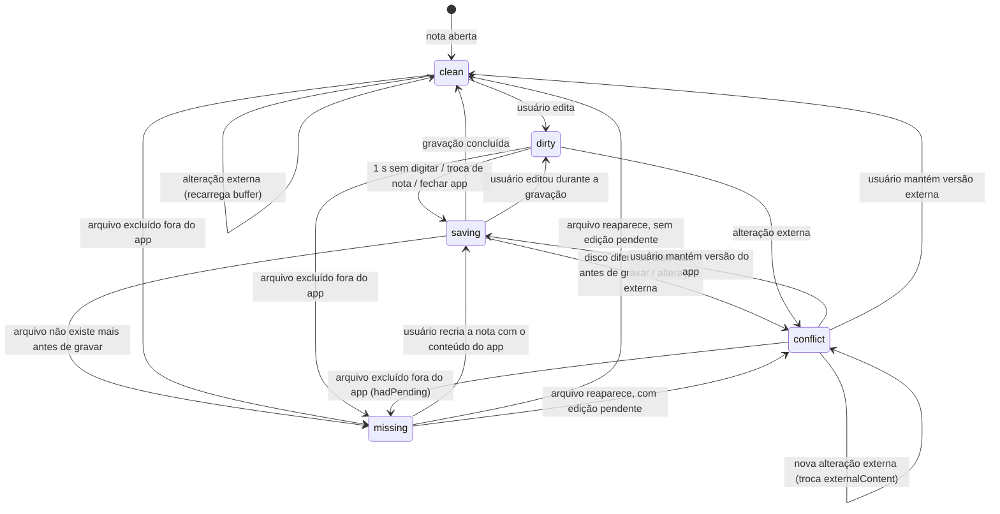

# Data Model: Vault e Notas

**Feature**: [spec.md](./spec.md) · **Plan**: [plan.md](./plan.md)

Os arquivos no disco são a fonte da verdade (constituição, princípio II). Nada abaixo é
persistido como verdade, exceto onde indicado como **persistido**. Tudo o que é derivado pode ser
reconstruído relendo o vault.

## Convenções

- **Caminho do vault** (`VaultPath`): texto relativo à raiz do vault, separado por `/`, sem `/`
  inicial e sem `.` ou `..` (ex.: `backend/api.md`). O adapter converte para o caminho do
  sistema operacional; nenhum código fora de `shared/vault` vê caminho absoluto, exceto
  `VaultRef.root`.
- **Chave de comparação** (`nameKey`): `nome.normalize("NFC").toLocaleLowerCase("pt-BR")`. Usada
  para detectar conflito de nome (spec, Assumptions: maiúsculas e minúsculas contam como iguais).
- **Nome de nota** (`basename`): nome do arquivo sem a extensão `.md`.

## Entidades

### VaultRef — **persistido** (dados do app, fora do vault)

| Campo | Tipo | Regra |
| --- | --- | --- |
| `root` | caminho absoluto | Pasta escolhida pelo usuário (FR-001) |
| `name` | texto | Nome da pasta, exibido no topo do `app-shell` |
| `lastOpenedAt` | data ISO | Atualizado a cada abertura |

Guardado nas configurações do app (fora do vault), para reabrir o último vault (FR-001). Um vault
aberto por vez.

### VaultEntry

| Campo | Tipo | Regra |
| --- | --- | --- |
| `path` | `VaultPath` | Único no vault |
| `kind` | `folder` \| `note` \| `canvas` \| `other` | `note` = `.md`; `canvas` = `.canvas` |
| `name` | texto | Nome exibido (nota sem `.md`) |
| `parent` | `VaultPath` \| raiz | Pasta que contém a entrada |

- A árvore exibe `folder`, `note` e `canvas` (FR-002). `other` existe só para contagem na
  exclusão de pasta (Edge Cases).
- Pastas e arquivos cujo nome começa com `.` (inclui `.devnotes/`) são ignorados.
- Links simbólicos não são seguidos nem listados (Edge Cases).
- Entradas `canvas` aparecem na árvore mas não abrem nesta feature.

### Note

| Campo | Tipo | Regra |
| --- | --- | --- |
| `path` | `VaultPath` | Termina em `.md` |
| `folder` | `VaultPath` \| raiz | |
| `basename` | texto | Único por `nameKey` dentro de `folder` (FR-013, FR-016) |
| `content` | texto | Lido do disco sob demanda |

**Validação de nome** (FR-005): não vazio após `trim`; sem `/ \ : * ? " < > |` nem caracteres de
controle; não começa com `.` (a entrada ficaria oculta, ver acima); não termina em `.` ou espaço;
não é nome reservado do Windows (`CON`, `PRN`, `AUX`, `NUL`, `COM1`–`COM9`, `LPT1`–`LPT9`, com
ou sem extensão). A mesma regra vale para pastas.

### OpenNote (estado em memória da nota aberta)

| Campo | Tipo | Regra |
| --- | --- | --- |
| `path` | `VaultPath` | |
| `buffer` | texto | O que o usuário vê e edita |
| `diskHash` | hash | Hash do último conteúdo lido ou gravado pelo app |
| `lineEnding` | `"\n"` \| `"\r\n"` | Detectado na leitura (a primeira quebra do arquivo; `"\n"` se não houver) e reaplicado ao gravar (FR-004) |
| `bom` | booleano | `true` se o arquivo começa com U+FEFF; o BOM sai do `buffer` e volta ao gravar (FR-004) |
| `status` | ver máquina de estados | |
| `externalContent` | texto \| vazio | Preenchido só em `conflict` |
| `hadPending` | booleano | Só em `missing`: havia edição pendente quando o arquivo sumiu. Decide se "Recriar" aparece |

**Máquina de estados** (FR-004, FR-021–FR-023, RN-NOTA-007/008):



- "Edição pendente" = `status ∈ {dirty, saving, conflict}`, ou `missing` com `hadPending`.
- Em `conflict`, nenhuma gravação automática acontece até o usuário escolher (FR-022).
- **Gravar só sobre o que o app conhece** (FR-022, SC-005, princípio II): antes de toda gravação
  automática, o app lê o arquivo e compara o `sha256Hex` com `diskHash`. O observador só avisa
  depois de 300 ms e do cálculo do hash, então uma alteração externa pode chegar antes dele.
  - Se o hash for diferente, a gravação não acontece e a nota vai para `conflict` com o conteúdo
    lido em `externalContent`.
  - Se o arquivo não existir, a nota vai para `missing`.
  - Resta só a janela entre essa leitura e a gravação, de poucos milissegundos.
- "Manter minha versão" grava sem essa checagem: primeiro faz `diskHash = hash(externalContent)`,
  depois grava o `buffer`. "Recriar" também grava sem checar.

### LinkOccurrence (derivado, índice em memória)

| Campo | Tipo | Regra |
| --- | --- | --- |
| `source` | `VaultPath` | Nota que contém o link |
| `range` | início/fim no texto | Posição exata de `[[...]]` ou `![[...]]` |
| `target` | texto | Parte antes de `#` e `|`, sem `.md` (ex.: `api`, `backend/api`) |
| `subpath` | texto \| vazio | `#título` ou `#^bloco`, preservado na reescrita |
| `alias` | texto \| vazio | Parte após `|`, preservada na reescrita |
| `embed` | booleano | `true` para `![[...]]` |

- Links dentro de blocos de código (cercas ` ``` ` e código inline) não contam.
- **Resolução** (RN-LINK-004): `target` com `/` → caminho exato; sem `/` → a nota cujo `basename`
  tem o mesmo `nameKey`; se houver mais de uma, o link é ambíguo e não é reescrito sozinho (só a
  regra RN-LINK-006 decide, veja ChangePlan).
- A gramática completa dos links é da spec de links (002); aqui só o necessário para reescrever.

### CanvasFileRef (derivado)

| Campo | Tipo | Regra |
| --- | --- | --- |
| `canvas` | `VaultPath` | Arquivo `.canvas` |
| `nodeId` | texto | `id` do nó JSON Canvas |
| `file` | `VaultPath` | Campo `file` do nó `type: "file"` (caminho a partir da raiz do vault, com extensão) |

Reescrever um cartão altera só o campo `file` do nó; o resto do JSON é preservado (FR-012).

### ChangePlan

Um só tipo para renomear e mover. Calculado inteiro antes de qualquer gravação (FR-019).

**Ordem da operação**: esperar o índice → calcular os caminhos afetados (notas movidas, notas
com links para elas e canvas que as referenciam) → `onBeforeMutate(afetados)`, em que o editor
grava a nota aberta → calcular o plano → aplicar → `moved` e `rewritten` (ver VaultEvent). O
plano é calculado **depois** do `onBeforeMutate` para que o `before` de cada edição já inclua a
gravação feita pelo editor.

| Campo | Tipo | Regra |
| --- | --- | --- |
| `kind` | `rename` \| `move` | Pasta renomeada/movida gera um plano com várias notas (FR-018) |
| `moves` | lista de `{from, to}` | Arquivos e pastas a renomear/mover |
| `edits` | lista de `{path, before, after}` | Notas e canvas a regravar; `before` é o hash lido |
| `conflicts` | lista | Se não vazia, nada é gravado e o usuário é avisado (FR-013, FR-016) |

**Cálculo dos `edits`**:

1. Para cada link que resolve para a nota movida: o novo texto usa só o nome se o nome continua
   único no vault depois da operação; senão usa `pasta/nome` (RN-LINK-004, FR-011, FR-015).
2. Se a operação torna um `basename` repetido, todo link que usava só o nome e resolvia para a
   **outra** nota passa a `pasta/nome` dela (RN-LINK-006, FR-014).
3. Cada `CanvasFileRef` com `file` igual ao caminho antigo recebe o novo caminho (FR-012).
4. `subpath`, `alias` e a marca de incorporação (`!`) são preservados.

**Aplicação**: move primeiro, depois as edições, em sequência. Antes de cada edição o hash do
arquivo é conferido; se mudou fora do app, a edição é pulada e entra no relatório. Falhas não
desfazem o que já foi aplicado; o relatório lista notas e canvas não atualizados (FR-020).

### DeletionRequest

| Campo | Tipo | Regra |
| --- | --- | --- |
| `target` | `VaultPath` | Nota ou pasta |
| `noteCount` | número | Notas dentro da pasta (RN-NOTA-009) |
| `otherCount` | número | Tudo o que não é nota, inclusive canvas (Edge Cases) |

Fluxo: confirmação (`app-confirm`) → `Trash.moveToTrash(target)`. Se a lixeira estiver
indisponível, nada é alterado e o usuário é avisado (FR-024). Nenhuma nota é reescrita: os links
para a nota excluída continuam no texto (RN-NOTA-003).

### WriteLedger (em memória, dentro de `shared/vault`)

| Campo | Tipo | Regra |
| --- | --- | --- |
| `path` | `VaultPath` | Arquivo gravado, movido ou excluído pelo app |
| `hash` | hash \| vazio | Conteúdo esperado depois da gravação |
| `expiresAt` | instante | Janela curta (padrão 2 s) |

Um evento do observador que casa com uma entrada do ledger é descartado (FR-023). Qualquer outro
evento vira `ExternalChange`. Um eco que chega depois de a entrada expirar (ex.: renomear em lote
demorado) também vira `ExternalChange`, por isso o `vault.store` trata `created` e `removed` de
forma idempotente.

### ExternalChange

| Campo | Tipo |
| --- | --- |
| `kind` | `created` \| `modified` \| `removed` |
| `path` | `VaultPath` |

Renomear/mover fora do app chega como `removed` + `created` (Edge Cases): links não são
atualizados. `{ kind: "removed", path: "" }` significa que a raiz do vault sumiu ou ficou
inacessível; o `vault.store` passa para `status: "unavailable"`.

### VaultEvent (ganchos do `vault.store` para outras features)

O `vault.store` não conhece o `editor`. Quem precisa reagir a operações do vault se registra nestes
ganchos (dependência `editor → vault`, nunca o contrário):

| Gancho | Quando dispara | Uso pelo `editor` |
| --- | --- | --- |
| `onBeforeMutate(paths)` | Antes de renomear, mover ou excluir; a operação espera a promessa. `paths` inclui as notas movidas ou excluídas e, ao renomear ou mover, também as notas e canvas que serão reescritos | Gravar a nota aberta se ela estiver entre os `paths` |
| `onEntryEvent(event)` | Depois da operação ou de uma mudança externa | Atualizar o caminho, fechar ou recarregar a nota, ou tratar conflito |

`event` é um destes:

- `{ kind: "moved", from, to }`: renomear ou mover feito pelo app, uma entrada por nota afetada;
- `{ kind: "removed", path }`: excluído pelo app;
- `{ kind: "rewritten", path }`: nota ou canvas cujos links o app reescreveu num `ChangePlan`.
  Como o observador ignora as escritas do app (FR-023), é por aqui que o editor recarrega a nota
  aberta. Em `clean`, troca o buffer e o `diskHash`. Em `dirty`/`saving`, que só acontece se o
  usuário digitou durante a operação, vai para `conflict`;
- `{ kind: "external", change: ExternalChange }`: mudança feita fora do app.

## Relações

```text
VaultRef 1 ── * VaultEntry
VaultEntry(kind=note) 1 ── 1 Note
Note 1 ── * LinkOccurrence (como source)
Note 1 ── * LinkOccurrence (como destino resolvido)
Note 1 ── * CanvasFileRef
OpenNote 0..1 ── 1 Note
ChangePlan 1 ── * (moves, edits)
```
